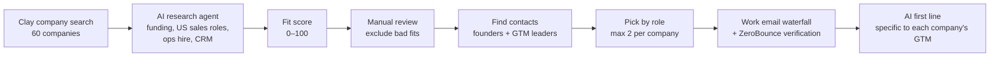
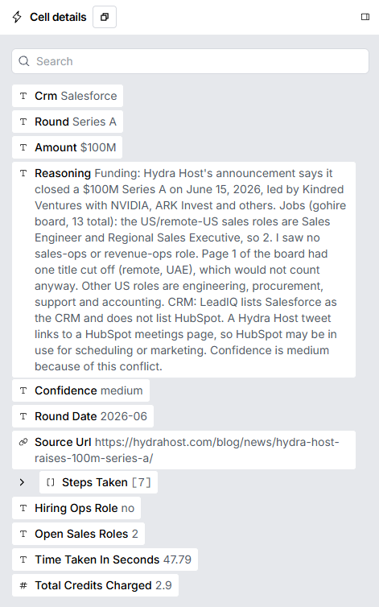
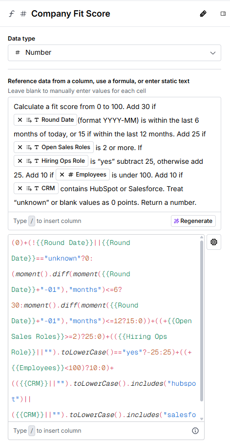
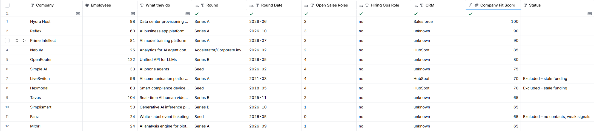
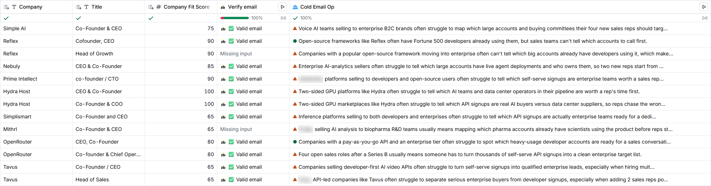

# Fractional GTM Prospector

A Clay workflow that finds funded B2B startups that are scaling a sales team **without anyone running GTM operations behind it**, scores them, and finds the right decision-maker with a verified email and an AI-written, company-specific opening line.

Built in Clay with Claude (Sonnet) as the research and writing agent, ZeroBounce for email verification, and a JavaScript scoring formula.

> **Portfolio:** [shahmeerk.com](https://shahmeerk.com)

---

## The problem

A startup that just raised a round and is hiring several account executives is about to have a GTM problem: new reps need target lists, lead routing, a clean CRM and pipeline reporting. Many of these companies haven't hired anyone in RevOps or marketing ops yet. That gap is the buying signal.

This project turns that idea into a repeatable pipeline: **find the companies, prove the signal, score them, and reach the right person with a reason to talk.**

## How it works

### 1. Company search (Clay)
Filters on Clay's company database:
- US-headquartered, privately held B2B software companies, 11–200 employees
- 15%+ headcount growth over the last 6 months
- **2+ AE / SDR / BDR roles posted in the last 60 days**
- **Nobody currently in RevOps, Marketing Ops, Sales Ops or GTM Engineering**
- Excludes consulting, agency, outsourcing and staffing firms

### 2. AI research agent (Claygent, Claude Sonnet)
One web-research column per company returns structured fields: latest round, amount, round date, open US sales roles, whether they're hiring an ops role, CRM in use, a confidence level and a source URL. See [`prompts/research.md`](prompts/research.md).

### 3. Fit score (formula column)
| Signal | Points |
|---|---|
| Raised in the last 6 months (last 12 months) | +30 (+15) |
| 2+ open US sales roles | +25 |
| Not hiring a RevOps / MOps role (hiring one) | +25 (−25) |
| Under 100 employees | +10 |
| Uses HubSpot or Salesforce | +10 |

Cutoff: **65+**. Formula in [`scoring/fit-score.js`](scoring/fit-score.js).

### 4. Contacts
- Clay "Find contacts at company" with founder, CEO, growth, marketing, sales and revenue titles, US only
- Results sent to a separate Contacts table, one row per person
- Picked by role: founder/CEO at smaller companies, the growth or sales leader at larger ones; CTOs skipped
- Work email waterfall, then ZeroBounce verification

### 5. AI-written opening line
A Claude column writes one sentence per contact about a GTM problem that companies like theirs typically face at their stage. Examples: turning self-serve API signups into sales leads, or spotting which enterprise accounts already use an open-source product. See [`prompts/first-line.md`](prompts/first-line.md).

---

## Results

| Stage | Count |
|---|---|
| Companies from search | 60 |
| Researched by AI agent | 50 |
| Scored 65+ | 12 |
| After manual review | 9 |
| Contacts found | 18 |
| Selected by role | 13 |
| Verified work emails | 11 (every email found came back valid) |

**Cost:** about 258 Clay credits for the whole build, including test runs and prompt iterations. The research agent cost ~1.8 credits per company, and email verification 0.1 per contact.

Scored company list (company-level data only): [`data/companies_scored.csv`](data/companies_scored.csv)

---

## What I changed and why

The first version of each step had a problem. Fixing them was most of the work.

**1. The search let in service firms.**
Consultancies and dev shops were tagged "Software Development" and slipped through. I added keyword exclusions, and one still got through by calling itself a "team provider," so I reviewed by hand before scoring.

**2. The agent couldn't confirm hiring.**
Careers pages often failed to load, and some "open sales roles" were based in India or the Middle East. I told the agent to fall back to Greenhouse, Lever, Ashby and LinkedIn Jobs, and to **count only US or remote-US roles**.

**3. The score passed companies with stale funding.**
Two companies scored 70 off hiring and CRM signals alone, with their last rounds in 2018 and 2021. Funding is the "why now" of the pitch, so I excluded them in review and set the cutoff at 65. Next version: make recent funding a hard requirement.

**4. The first AI opening lines were one sentence with the numbers swapped.**
v1 produced lines like *"With four sales roles open at [Company], new reps will ramp faster if the pipeline, routing and CRM are already built."* That's 18 nearly identical lines, which any founder would spot as a template. I rewrote the prompt to make the AI reason about **who each company sells to** and name a GTM problem specific to that model, and banned the stock phrasing. v2 lines are about the company's actual business:

> *"Open-source frameworks like Reflex often have Fortune 500 developers already using them, but sales teams can't tell which accounts to call first."*
>
> *"Four open sales roles after a Series B usually means someone has to turn thousands of self-serve API signups into a clean enterprise target list."* (OpenRouter)

**5. Run conditions.**
Several columns ran on every row instead of only the selected contacts, which wasted a few credits. The lesson: set the condition before saving and check that it's there.

---

## What I'd build next

- Make "raised in the last 12 months" a hard filter, not just points
- Add a Claygent check for whether the company already uses an outside RevOps agency
- Push qualified contacts into a sequencer with the first line as a merge field
- Re-run weekly as new funding rounds and job postings appear

## Privacy

This repo contains **company-level data only** (public funding and hiring information). No contact names, emails or LinkedIn URLs are published.

## Tools

Clay (company search, Claygent, find contacts, email waterfall) · Claude Sonnet · ZeroBounce · JavaScript (scoring formula) · Google Sheets

---

**Shahmeer Khan** — GTM Engineer · [shahmeerk.com](https://shahmeerk.com) · [LinkedIn](https://www.linkedin.com/in/shahmeer-k/) · [GitHub](https://github.com/shahmeerk-gtm)
